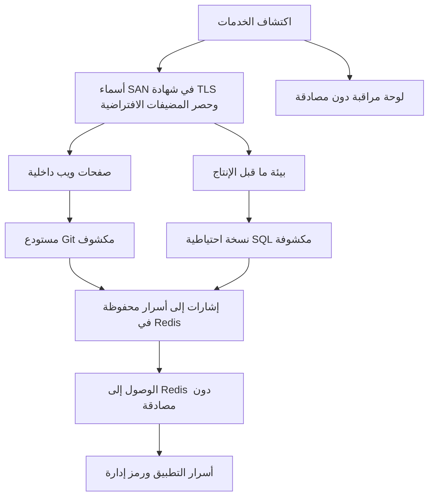

<div dir="rtl">

<div align="center">

# MegaCorp · تدقيق أمن المعلومات

**تقييم أمني خارجي بأسلوب الصندوق الأسود ضمن بيئة تدريب مصرح بها.**

استطلاع، وتحقق يدوي، وأدلة تقنية، وخطة معالجة مرتبة بحسب الأولوية.

[الاطلاع على التقرير الكامل](./Informe_auditoria_Sysdig_AR_Fusha.pdf) · [استعراض النتائج](#النتائج) · [تتبع الروابط بين النتائج](#ترابط-النتائج)

</div>

---

## نظرة عامة

| مستوى المخاطر العام | النتائج الموثقة | لقطات الشاشة الداعمة | التقرير بالعربية الفصحى |
| :---: | :---: | :---: | :---: |
| **مرتفع** | **11** | **23** | **56 صفحة** |

يوثق هذا المستودع تقييمًا أمنيًا **لبيئة MegaCorp التدريبية**. بحث التدقيق كيف يمكن للخدمات المكشوفة للعامة، وضعف ضوابط الوصول، وأخطاء النشر أن تكشف تطبيقات داخلية ونسخًا احتياطية لقواعد البيانات وشيفرة مصدرية وأسرار التطبيقات.

يربط التقرير كل نتيجة بالأدلة التي تدعمها، وخطوات إعادة إنتاجها، وأثرها المحتمل، وإجراءات المعالجة الموصى بها.

## التقرير

📄 **[تنزيل تقرير التدقيق الكامل بالعربية الفصحى أو عرضه](./Informe_auditoria_Sysdig_AR_Fusha.pdf)**

يتضمن ملف PDF:

- ملخصًا تنفيذيًا وتقييمًا عامًا للمخاطر.
- نطاق التدقيق وقواعد الاشتباك وحدود الاختبار.
- خريطة للخدمات المكشوفة والمضيفات الافتراضية ذات الصلة.
- نتائج تفصيلية مدعومة بالأوامر ولقطات الشاشة والأدلة.
- سردًا لسلسلة الهجوم وخطة معالجة مرتبة بحسب الأولوية.
- ملحقًا بالأدوات وقوائم الكلمات وسكربت Bash مخصص.

هذه ترجمة إلى العربية الفصحى للتقرير الإسباني الأصلي. حُفظت المعرفات التقنية والأوامر وقيم الأدلة دون تغيير، وأُضيفت ترجمة نصوص لقطات الشاشة بجانب صورها الأصلية عند الحاجة.

## النطاق والمنهجية

شمل التقييم المضيف التدريبي المحدد والخدمات المرتبطة به، وهي **HTTP وHTTPS وFTP وRedis**، بما في ذلك المضيفات الافتراضية ضمن النطاق `megacorp.lab`.

مر العمل بمراحل الاستطلاع والحصر والتحقق اليدوي وإعداد التقرير، مع الاسترشاد بمنهجية **PTES** و**دليل OWASP لاختبار أمن تطبيقات الويب (WSTG)**.

| المرحلة | المهام |
| --- | --- |
| **الاكتشاف** | تحديد المنافذ والخدمات والإصدارات المكشوفة، والمعلومات الواردة في شهادة TLS. |
| **الحصر** | تحديد المضيفات الافتراضية وموارد الويب والأدلة والمستودعات المتاحة. |
| **التحقق** | تأكيد انكشاف الموارد وغياب المصادقة وإفشاء المعلومات الحساسة يدويًا. |
| **التوثيق** | تسجيل الأدلة وشرح الأثر والتوصية بإجراءات معالجة عملية. |

أُجريت الاختبارات ضمن بيئة تدريب مصرح بها. استبعدت قواعد الاشتباك هجمات حجب الخدمة، وهجمات القوة الغاشمة ضد خدمات المصادقة، وتعديل بيانات الهدف أو حذفها، والانتقال إلى أنظمة خارج النطاق المحدد.

## النتائج

| المعرف | النتيجة | درجة الخطورة |
| --- | --- | :---: |
| **F-01** | الوصول المجهول إلى خدمة FTP | متوسطة |
| **F-02** | إفشاء المعلومات عبر `robots.txt` | منخفضة |
| **F-03** | كشف معلومات داخلية من بيئة ما قبل الإنتاج | متوسطة |
| **F-04** | نسخة احتياطية لقاعدة البيانات متاحة للعامة في بيئة ما قبل الإنتاج | مرتفعة |
| **F-05** | مثيل Redis متاح دون مصادقة | مرتفعة |
| **F-06** | مستودع Git مكشوف للعامة | مرتفعة |
| **F-07** | إفشاء الشيفرة المصدرية وأسرار التطبيق | مرتفعة |
| **F-08** | شهادة TLS موقعة ذاتيًا تكشف أسماء مضيفات داخلية | متوسطة |
| **F-09** | مضيف افتراضي داخلي متاح عبر ترويسة `Host` | مرتفعة |
| **F-10** | مستودع Git مكشوف في تطبيق Legacy Billing | مرتفعة |
| **F-11** | لوحة مراقبة داخلية متاحة دون مصادقة | مرتفعة |

<details>
<summary><strong>ملاحظة بشأن عدد النتائج ودرجات الخطورة</strong></summary>

يتبع الجدول معرفات النتائج ودرجات خطورتها الفردية الواردة في القسم التفصيلي من التقرير. تختلف الأعداد الإجمالية بحسب الخطورة في الملخص التنفيذي عن تلك النتائج التفصيلية.

تصف النتيجتان F-06 وF-07 مرحلتين مترابطتين من سلسلة الانكشاف نفسها، بينما تتعلق F-10 أيضًا بمستودع Git الخاص بتطبيق Legacy Billing. لذلك تشمل النتائج الإحدى عشرة مسائل مترابطة، ولا تمثل أحد عشر مسار هجوم مستقلًا.

تحافظ ترجمة التقرير على ترقيم المستند الأصلي وتقييماته.

</details>

## ترابط النتائج

كشفت نقاط ضعف منفردة في الإعدادات معلومات ساعدت على تحديد موارد إضافية. يلخص المخطط العلاقات التي تدعمها الأدلة، ولا يمثل تسلسلًا زمنيًا صارمًا للاختبارات.

<div dir="ltr">



</div>

الدرس الرئيسي هو أن إفشاء المعلومات وغياب ضوابط الوصول قد يعزز أحدهما الآخر: تكشف الشهادة أسماء المضيفات، وتشير صفحة داخلية إلى تطبيق قديم، وتكشف الملفات المتاحة مواضع تخزين البيانات الحساسة.

## الأدوات

| مجال الاستخدام | الأدوات |
| --- | --- |
| اكتشاف المنافذ والخدمات | Nmap |
| فحص شهادة TLS | OpenSSL |
| فحص HTTP وحصر موارد الويب | cURL, ffuf, Gobuster |
| استرجاع المستودع ومراجعة الشيفرة المصدرية | Wget, Git |
| التحقق من Redis | redis-cli |
| إرسال طلبات متكررة إلى المضيفات الافتراضية | سكربت Bash مخصص |

## أولويات المعالجة

1. **إزالة ملفات التطوير المكشوفة.** حفظ بيانات Git الوصفية ونسخ قواعد البيانات وملفات الإعداد الحساسة خارج الأدلة المتاحة للعامة عبر خادم الويب.
2. **حماية الخدمات الداخلية.** تطبيق المصادقة والتخويل وتقسيم الشبكة، وفرض القيود المناسبة باستخدام الجدار الناري أو VPN.
3. **استبدال الأسرار المكشوفة.** تغيير بيانات الاعتماد ورموز الوصول التي كُشفت، ومنع إعادة استخدام بيانات الاعتماد بين البيئات.
4. **تقوية إعدادات الويب وTLS.** تعطيل عرض محتويات الأدلة غير الضروري، ومراجعة محتوى الشهادات وموثوقيتها.
5. **مراجعة عمليات النشر قبل الإطلاق.** فحص الملفات المنشورة، وإخراج التطبيقات المتقادمة من الخدمة، وإعادة تقييم انكشاف الخدمات دوريًا.

## بنية المستودع

<div dir="ltr">

```text
.
├── README.md
└── Informe_auditoria_Sysdig_AR_Fusha.pdf
```

</div>

---

**المحللة:** بالوما كاسابونا أغودو (Paloma Casabona Agudo)  
**تاريخ التدقيق:** 2 يوليو 2026  
**إصدار التقرير:** 1.0

</div>
